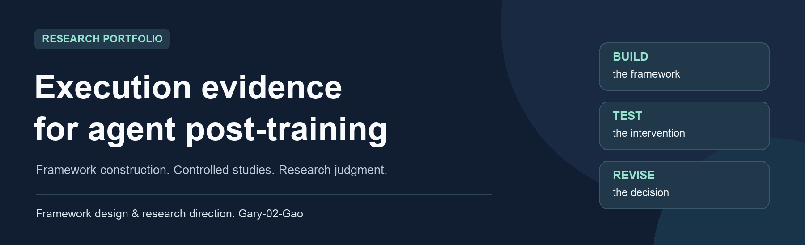

[中文介绍](README.zh-CN.md) · [Framework](docs/FRAMEWORK.md) · [Selected findings](docs/FINDINGS.md) · [Research judgment](docs/RESEARCH_JUDGMENT.md)

**Framework designed and built by [Gary-02-Gao](https://github.com/Gary-02-Gao).** The author also leads research direction, critical human review and experimental decisions. Codex assisted with later experiment-specific implementation, execution and archiving.

## The question

**When does execution evidence help us choose a better post-training intervention?**

A tool-using agent must decide when to obtain evidence, act, request missing information or stop. This project connects those decisions to observable actions and environment outcomes, then asks whether training is a better investment than a competitive simpler approach.

Synthetic refund tasks provide the current experimental setting. The research concerns agent learning and evaluation, with refund handling serving as a bounded test environment.

## Three parts of the work

| Build | Test | Revise |
| --- | --- | --- |
| Construct an agent framework connecting execution, tools, state, evidence and training interfaces. | Run controlled SFT comparisons and evaluate both responses and operations. | Accept negative findings, retain stronger baselines and adjust the next investment. |

## Selected findings

| Study | Observation | What changed |
| --- | --- | --- |
| First SFT | Human-reviewed joint pass: **1/8 → 5/8** | Execution improved in the evaluated batch; incorrect actions remained. |
| Stopping-history intervention | Controlled full-task retest: **6/8 → 8/8**; separate local decisions: **0/4 → 4/4** | A specific positive SFT case was retained. |
| Diagnostic design D vs conventional design S | New paired tasks: **6/8 vs 8/8**; both stopped correctly in **2/2** stopping cases | **S was selected.** The more elaborate diagnostic design showed no added benefit in this comparison. |

These are small studies within one synthetic task family. They use different evaluation sets and cannot be pooled into a general success rate. The stopping retest reused full-task instances; local next-decision cases are a separate measure. [Read the interpretation](docs/FINDINGS.md).

## Research judgment in practice

- Evaluate attempted actions as well as the final answer and resulting state.
- Control the inputs before attributing a favorable difference to training.
- Give simpler alternatives a competitive comparison and retain negative results.
- Distinguish missing model knowledge from interface ambiguity and reviewer-visible truth.

[Five decisions that shaped the project →](docs/RESEARCH_JUDGMENT.md)

## About this portfolio

This repository contains **presentation documents and static images only**. It summarizes the framework, author contribution and selected findings; implementation and operational materials are maintained separately and privately. It is not an open-source code release or a reproduction package.

The work does not claim a new training algorithm, established RL gains, production reliability, or a demonstrated general advantage of execution-guided diagnosis. That final question remains the research objective.
