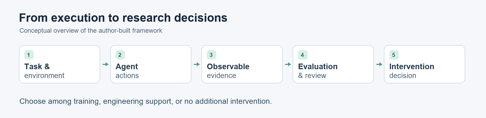

# An author-built framework for agent research

The project framework was designed and constructed by **Gary-02-Gao**. It provides the foundation for connecting tool-using agent behavior with later training and evaluation decisions.

## Responsibilities of the framework

| Component | Purpose |
| --- | --- |
| Agent execution | Organize successive actions and responses to environmental feedback. |
| Tools and environment | Represent queries, actions and observable state changes within a controlled setting. |
| Evidence organization | Relate task context, available observations, attempted actions and outcomes. |
| Evaluation | Inspect final language, operational behavior and resulting state as distinct dimensions. |
| Post-training interfaces | Support data preparation and integration with training workflows. |

This is a conceptual description. It does not disclose implementation structure or executable interfaces.

## Why this architecture matters

An agent can produce an accurate final answer after making a wrong request that a tool blocked. It can also describe a valid action without actually taking it. Keeping the evidence and execution outcome connected makes these cases distinguishable.

The framework enabled later controlled experiments. The research contribution of an intervention is evaluated through those experiments; it does not follow automatically from having more infrastructure.

## Contribution and collaboration

The author's contribution combines overall framework construction, research problem definition, experimental constraints, key human trajectory review and decisions about which approach to retain.

Codex assisted with later experiment-specific implementation, execution and evidence archiving. Additional exploratory judgments made only by Codex are kept distinct from the author's manual review. Third-party model and training libraries remain the work of their respective authors.

[Return to the portfolio](../README.md)
